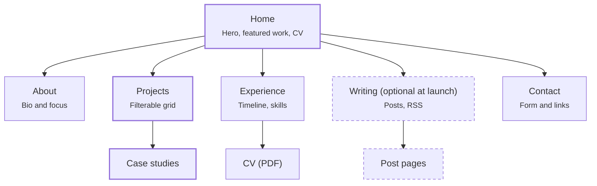

# Personal Portfolio Website — UI and UX Design

Nov 26, 2026 · Dinith Jayabodhi

The look is clean, content-first, and restrained, so the projects carry the page. A visitor on a phone should be able to judge fit in a 60-second skim and reach any project case study in 2 clicks.

## Site map and navigation

The site has six top-level pages kept flat, so any page is reachable in one click from Home and any case study in two.

- No more than 5 items in the top navigation; sticky header on desktop, compact menu on mobile.
- Clean, readable URLs such as `/projects/rdu-api` and `/writing/post-slug`.
- Primary action (View projects or Contact) visible above the fold on every key page.

## Visual design system

| Element | Guideline |
| --- | --- |
| Layout | Single column on mobile, 12-column grid on desktop; content max width about 720 px for text, 1200 px for grids |
| Typography | One sans-serif for UI and body (16–18 px base, 1.6 line height), one monospace for code; at most 2 families |
| Colour | Neutral base plus one accent colour for links and calls to action; full light and dark palettes; text contrast ≥ 4.5:1 |
| Spacing | 8 px spacing scale used consistently |
| Imagery | Real screenshots and architecture diagrams over stock photos; WebP or AVIF, lazy-loaded below the fold |
| Motion | Subtle transitions under 200 ms; disabled when the visitor prefers reduced motion |
| Theme | Light and dark theme toggle that respects the system setting |

Create a small style guide page (colours, type scale, buttons, cards, tags) before building pages, so components stay consistent.

## Page UI elements

### Home

- Hero: name, title, one-line value statement, and two buttons: View projects (primary) and Download CV (secondary).
- Headshot or simple monogram beside or above the hero text.
- Featured projects: 3 cards, each with title, one-line outcome, tech tags, and a link to the case study.
- Credibility strip: years of experience, current domain, key certifications.
- Latest 2–3 posts, if Writing is enabled.

### Projects index and case studies

- Index: card grid with filter chips by technology or type (API, infrastructure, data, tooling, personal).
- Case study page follows one fixed layout: summary, context and problem, role, architecture diagram, tech stack, outcome, lessons learned, links.
- Outcome numbers are visually emphasised; links to demo and repository sit at the top and bottom of the page.

### Experience and skills

- Vertical reverse-chronological timeline with role, company, dates, and 3–4 impact bullets.
- Prominent Download CV button.
- Skills shown as grouped tags by area, with no star ratings or percentage bars; each tag links to a project that shows it.

### Contact

- Short form (name, email, message) with inline validation and a clear success or error message.
- LinkedIn and GitHub links and the expected response time beside the form.

### Global elements

- Header with name and navigation; footer with social links, copyright, and last-updated date.
- Custom 404 page that links back to Projects.

## Accessibility and responsiveness

| Area | Requirement |
| --- | --- |
| Accessibility | WCAG 2.2 AA: semantic HTML, keyboard navigation, visible focus, alt text on every image, skip-to-content link |
| Responsiveness | Tested at 360 px, 768 px, 1280 px, and 1920 px widths, on Chrome, Safari, Firefox, and Edge |
| Perceived speed | Largest Contentful Paint under 2.0 s and layout shift under 0.1 on mobile, so pages feel instant and stable |
